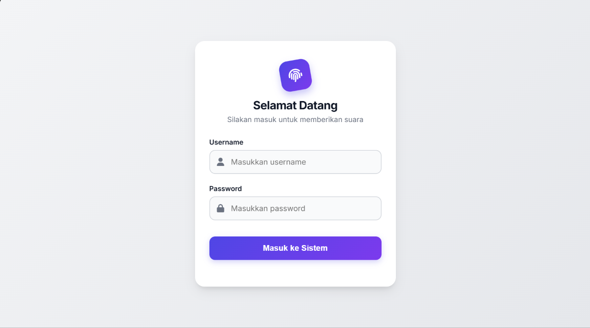
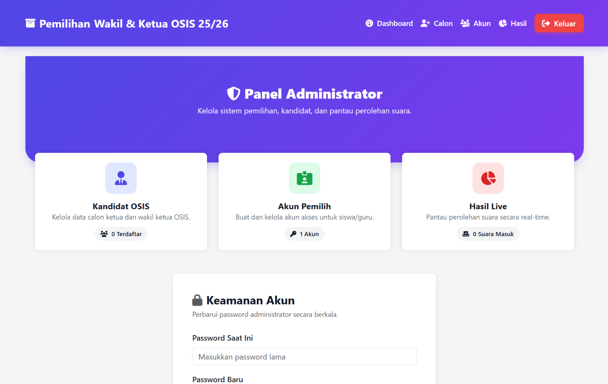
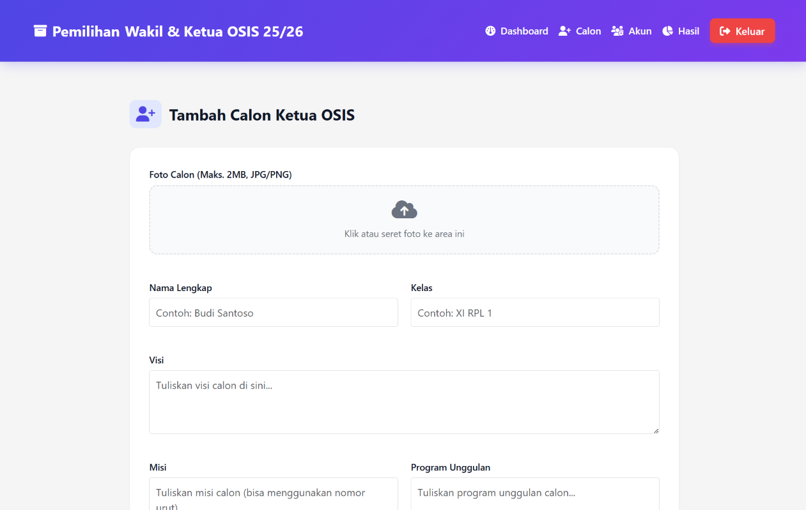

<h1 align="center">🗳️ Pilketos Web App</h1>

<p align="center">
  <i>Sistem Pemilihan Ketua & Wakil Ketua OSIS Digital Berbasis Web</i><br>
  <b>Main App:</b> Native PHP 8 + MySQL (PDO) &nbsp;|&nbsp; <b>Interactive Demo:</b> React + Vite + TypeScript (Vercel-ready)
</p>

---

## 📖 Deskripsi

**Pilketos Web App** adalah sistem pemilihan ketua OSIS berbasis web untuk lingkungan sekolah dengan dukungan multi-role (**Admin**, **Guru**, dan **Siswa**).

Repositori ini berisi dua bagian yang terpisah:
1. **Aplikasi Utama (PHP 8 + MySQL)** — Aplikasi produksi penuh dengan autentikasi berbasis session, proteksi CSRF, pemungutan suara atomik, upload foto tervalidasi, dan sistem migrasi database CLI.
2. **Aplikasi Demo Interaktif (`demo/`)** — Simulasi frontend mandiri (React + Vite + TypeScript) tanpa backend PHP/MySQL yang siap di-deploy ke **Vercel**. Seluruh data pada demo bersifat fiktif dan tersimpan lokal di `localStorage` browser.

---

## 🚀 Live Demo (Vercel)

> [!NOTE]
> **Mode Demo Interaktif**: Data kandidat, akun, dan perolehan suara pada versi demo bersifat **fiktif** dan hanya tersimpan di browser pengunjung (`localStorage`), bukan hasil pemilihan nyata.

- **Deploy Target**: Folder `demo/` (atur **Root Directory** = `demo` di Vercel).
- **Live URL**: *Tambahkan URL Vercel Anda di sini setelah deploy M5 (mis. `https://pilketos-demo.vercel.app`).*
- **Akses Cepat Demo**: Tersedia tombol login 1-klik untuk peran **Siswa**, **Guru**, dan **Admin**, atau login manual dengan akun fiktif:
  - Siswa: `siswa_demo` / `demo123`
  - Guru: `guru_demo` / `demo123`
  - Admin: `admin_demo` / `demo123`

---

## ⚙️ Fitur Utama (Aplikasi Utama)

- 🔐 **Autentikasi & Keamanan Session**
  - Multi-role login (`admin`, `guru`, `siswa`) dengan hash `PASSWORD_BCRYPT` (`masuk.php`, `keluar.php`).
  - Proteksi CSRF di seluruh form `POST`, `session_regenerate_id(true)` saat login, dan cookie session `HttpOnly` + `SameSite=Lax`.
- 🗳️ **Pemungutan Suara Atomik (`user/vote.php`, `user/vote_guru.php`)**
  - Validasi kandidat, pembaruan atomik `users.sudah_vote = 1 WHERE id = ? AND sudah_vote = 0`, pencatatan `votes.guru_vote`, dan constraint `UNIQUE(user_id)` di database untuk mencegah suara ganda.
  - Penegakan jadwal & status buka/tutup voting secara otomatis di sisi server.
- 🛠️ **Panel Administrator (`admin/`)**
  - **Pengaturan Pemilihan** (`admin/dashboard.php`): Atur judul pemilihan, waktu mulai/selesai, dan status buka/tutup voting.
  - **Manajemen Kandidat** (`admin/tambah_calon.php`): Tambah, edit, dan hapus paslon (dilengkapi validasi MIME `finfo_file()` + `getimagesize()`, batas 2 MB, serta proteksi hapus jika paslon sudah memiliki suara).
  - **Manajemen Akun Pemilih** (`admin/tambah_akun.php`): Tambah akun `siswa`/`guru`, reset password, dan hapus akun yang belum memilih.
  - **Live Count & Laporan** (`admin/hasil.php`): Grafik batang interaktif **Chart.js**, tabel persentase perolehan suara, tombol refresh, dan dukungan cetak (`@media print`).
  - **Keamanan Akun** (`admin/ubah_password.php`): Ganti password admin dengan validasi minimal 6 karakter.

---

## 🛠️ Tech Stack & Struktur Proyek

| Komponen | Teknologi |
| :--- | :--- |
| **Main Backend** | PHP 8.x (Native, PDO Prepared Statements) |
| **Main Database** | MySQL / MariaDB + CLI Migration Runner (`database/migrate.php`) |
| **Main Frontend** | HTML5, CSS3, Bootstrap 5.3.3, Font Awesome 6.4.0, Chart.js |
| **Demo Frontend** | React 19, Vite 6, TypeScript, React Router, Chart.js, Lucide Icons |

```text
pemilihan_osis/
├── admin/                  # Panel admin (dashboard, calon, akun, hasil, ubah_password)
├── user/                   # Dashboard pemilih & halaman voting (siswa & guru)
├── includes/               # Env loader, koneksi PDO, helper auth/CSRF/jadwal, header & footer
├── database/
│   ├── migrations/         # 001_initial_schema.sql, 002_add_unique_vote_per_user.php, 003_add_election_settings.sql
│   ├── seeds/              # 001_admin_seeder.php (idempotent)
│   └── migrate.php         # Runner migrasi CLI
├── assets/                 # CSS, JS, dan gambar (termasuk default.jpg & candidates/)
├── demo/                   # Aplikasi demo interaktif (React + Vite + TS + vercel.json)
├── .env.example            # Template konfigurasi environment
└── README.md
```

---

## 🖼️ Preview

<p align="center">
  <br/>
  <br/>
  
</p>

---

## 💻 Instalasi Lokal (Aplikasi Utama PHP + MySQL)

### 1. Persiapan Environment
1. Pastikan **PHP 8.x** dan **MySQL** (mis. via Laragon atau XAMPP) berjalan, lalu letakkan proyek di `C:\laragon\www\pemilihan_osis` (atau `htdocs\pemilihan_osis`).
2. Salin `.env.example` menjadi `.env` dan sesuaikan konfigurasi database serta `BASE_URL`:
   ```env
   APP_ENV=local
   APP_DEBUG=true
   BASE_URL=http://localhost/pemilihan_osis

   DB_HOST=localhost
   DB_PORT=3306
   DB_DATABASE=pemilihan_osis
   DB_USERNAME=root
   DB_PASSWORD=
   ```

### 2. Migrasi Database & Seeder Admin
Jalankan perintah berikut dari root folder proyek:
```bash
php database/migrate.php --create-db
php database/seeds/001_admin_seeder.php
```
- Jika `SEED_ADMIN_PASSWORD` di `.env` dikosongkan, seeder akan membuat password acak satu kali dan menampilkannya di terminal.
- Untuk menjalankan ulang migrasi di masa depan, cukup jalankan `php database/migrate.php` (migrasi yang sudah diterapkan akan dilewati otomatis).

### 3. Akses Aplikasi
- Buka browser dan akses **`http://localhost/pemilihan_osis/`**.
- Login sebagai **Admin** menggunakan username (`SEED_ADMIN_USERNAME`, default `admin`) dan password dari langkah seeder, lalu buat akun `siswa` / `guru` melalui menu **Akun**.

---

## 🖥️ Menjalankan Demo Secara Lokal (`demo/`)

```bash
cd demo
npm install
npm run dev
```
Untuk build produksi (seperti di Vercel):
```bash
cd demo
npm run build
```

---

## 🔒 Checklist Produksi & Keamanan

- Atur `APP_DEBUG=false` di `.env` agar detail error database tidak tampil ke publik.
- Pastikan file `.env` tidak dapat diakses publik melalui web server dan tidak pernah di-commit ke Git.
- Segera ubah password admin bawaan setelah login pertama melalui **Dashboard Admin → Keamanan Akun**.
- Gunakan **HTTPS** pada server produksi agar cookie session (`secure` flag) aktif secara otomatis.

---

## 🧑‍💻 Pengembang & Lisensi

**Sakti Arif Dwi Putra**  
💼 *Backend & Fullstack Developer*  
📍 Indonesia  

Proyek ini dirilis di bawah lisensi MIT — lihat [LICENSE](LICENSE).
